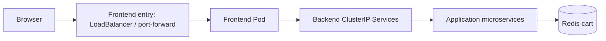

# Capstone 04 — Deploy Microservices Application in Kubernetes

**TechWorld with Nana · Module 10 · Engineering portfolio closed (24 October 2026)**

## Objective

Deploy the existing Online Boutique microservices application to Kubernetes using Deployment and Service manifests, an application namespace, internal backend networking and browser-accessible frontend. The TWN validation card also identifies production/security practices. **This portfolio is not recorded as officially accepted by TWN.**

## Architecture

[Architecture and environment boundaries](docs/architecture.md).

## Implementation

- **Local deployment:** a context-guarded k3d script fetches the pinned Online Boutique v0.8.0 Kubernetes release, validates manifests and applies them in `online-boutique`.
- **Existing AWS EKS environment:** Online Boutique was observed in namespace `online-shop` on two AMD64 nodes; 11 application Deployments available. This cluster **was not created or deployed by the CAP04 script**.
- **Networking:** 10 backend ClusterIP Services; existing frontend NodePort and LoadBalancer Services.
- **Tests:** EKS catalog, product details, cart and simulated checkout passed through browser. Separate disposable workloads demonstrated Pod self-healing and Deployment update/rollback.

## Outcome and limitations

| Check | Result |
|---|---|
| Local Kubernetes resources applied | Pass |
| Local shopping flow on Apple Silicon ARM64 | **Fail** — upstream v0.8.0 cartservice image incompatibility |
| Existing EKS application and browser workflow | Pass (operator-observed) |
| Kubernetes self-healing / rollback lab | Pass; temporary workloads removed |
| Exact TWN example parity | **Partial** — TWN checklist asks for authored manifests and three worker nodes; existing EKS has two |
| Reproducible EKS source and deployment | **Open** — original EKS configuration owner/source not identified |
| TWN acceptance | Not verified |

An incorrect live `adservice` image was corrected and validated. Its stale client-side last-applied data remained unresolved at inspection time; **do not apply the full upstream release to the existing EKS namespace**.

## Project files

| File | Purpose |
|---|---|
| [Architecture](docs/architecture.md) | System and deployment context |
| [Deployment evidence](docs/deployment.md) | Local run, incident, EKS tests |
| [Portfolio evidence](docs/portfolio-evidence.md) | Acceptance checks |
| [Official checklist comparison](docs/module10-official-checklist-gap-analysis.md) | Scope deviations from TWN materials |
| [Final report](docs/final-submission-report.md) | Consolidated evidence and limitations |
| [Operator runbook](docs/scripts-reference.md) | Commands, prerequisites, safety |
| [Closure](docs/capstone04-closure.md) | Final disposition |

`scripts/capstone04-cluster.sh` and `scripts/capstone04-deploy.sh` **operate on local k3d only**. `scripts/capstone04-eks-evidence.sh` is read-only. `scripts/bootstrap-github.sh` is historical and must not be rerun.

**Reference application:** [Online Boutique study repo](https://github.com/asambataiden/twn-devops-bootcamp-10-kubernetes-deploying-microservices-demo).

**TWN submission:** Link to [`main`](https://github.com/asambataiden/twn-capstone-04-kubernetes-microservices/tree/main) only after reviewer access and repository security review are resolved.
