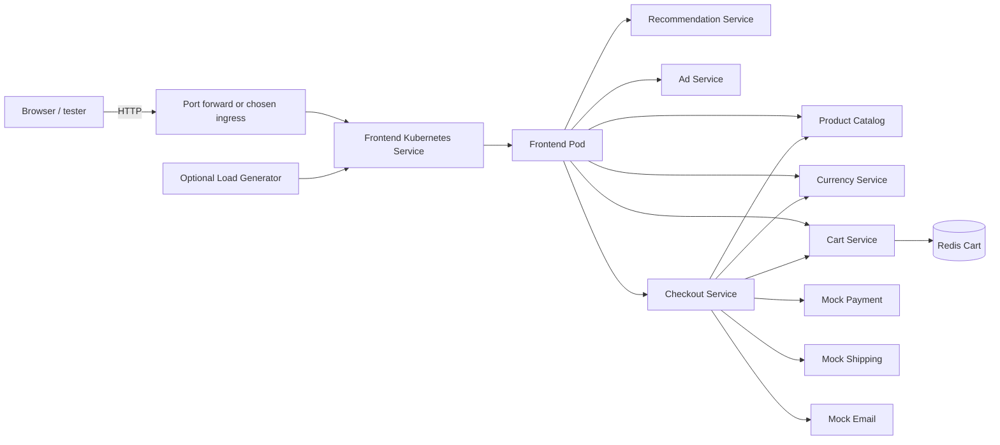
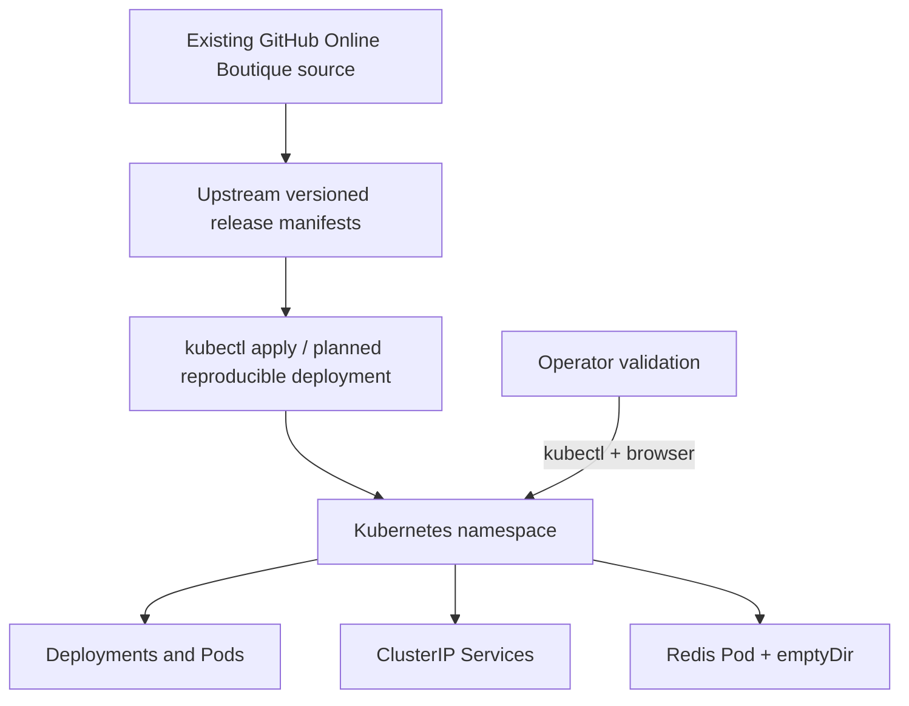

# CAP04-001 — Architecture Baseline

## Architecture scope

**Existing application:** Online Boutique from the user-maintained reference repository. **Planned capstone solution:** deploy it to Kubernetes and validate routing, service discovery, reliability and business flow. No live cluster has been configured as part of CAP04-001.

## System context

This diagram is a logical communication view; actual relationships should be verified from the deployed configuration and service-level instrumentation. Service names shown are the existing app responsibilities rather than a newly designed set of components.

## Deployment architecture

## Key choices

**Use existing contracts.** Do not change applications or gRPC contracts unless a demonstrated fault requires it.

**Keep service traffic internal.** Backend Services remain `ClusterIP`. Limit frontend exposure to the chosen entry point.

**Respect existing health/resource controls.** The checked-in manifests already have resource requests/limits and probes. Do not duplicate or overwrite without reason.

**Do not confuse demonstration with persistence.** Redis uses `emptyDir` in the observed manifest and is not durable across Pod replacement.

**Preserve provenance.** The release manifest is generated and should not be edited. A project-specific Kustomize overlay (only if necessary) or a documented Helm values file can capture intended environment changes.

**Cloud agnostic by default.** `kind` makes local validation inexpensive; managed Kubernetes is an explicit later decision dependent on TWN assessment requirements.

## Failure and rollback boundaries

- Losing a stateless application Pod is expected to trigger Kubernetes Deployment reconciliation; verify readiness before claiming recovery.
- Redis replacement may lose in-memory cart data; do not include it in a “no data loss” recovery test.
- Rollback is an optional extension with defined commands and expected result; not yet implemented.
- The initial baseline does not claim high availability, TLS public exposure, network-policy isolation or production security compliance.
