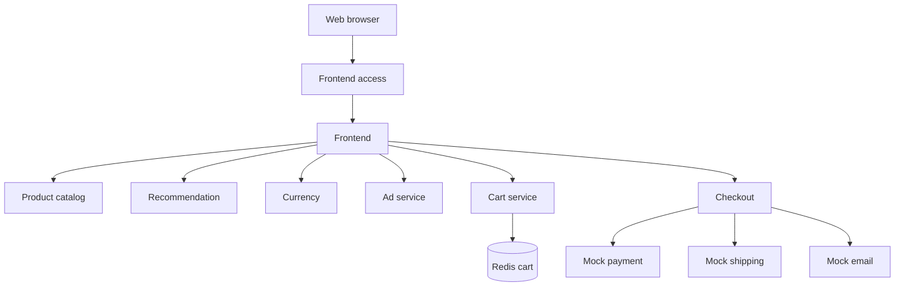
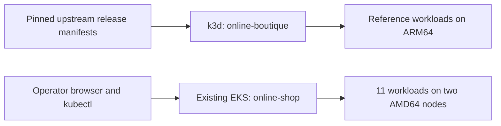

# Architecture — Capstone 04

## Purpose

Run the existing Online Boutique application on Kubernetes and verify service discovery, frontend access and e-commerce workflows. This is a **deployment project**, not a microservices rewrite.

## Logical application architecture

Each workload is reached by Kubernetes Service DNS; backend Services are internal ClusterIP. The diagram summarizes primary logical interactions, not an exhaustive distributed trace.

## Deployment environments

| Environment | Method | Outcome |
|---|---|---|
| Local k3d | Pinned release fetched, validated and applied through `capstone04-deploy.sh` | Resources applied; cartservice ARM64 failure prevented checkout |
| Pre-existing EKS | Read-only inventory, manual browser test, and one targeted Adservice fix | 11 available Deployments; catalog/cart/mock checkout verified |

**No capstone EKS provisioning pipeline is claimed.** The original EKS manifests have not been traced to an authoritative repository. The upstream release defines 12 Deployments, but EKS runs 11 (no loadgenerator).

## Design boundaries

- **Runtime separation:** local deployment scripts require the exact k3d context; EKS inventory script is read-only.
- **Network:** internal backend Services; a frontend LoadBalancer already exists in EKS. A separate NodePort Service also exists and requires its own security review.
- **Data:** Redis cart storage in the reference setup is ephemeral; no persistence or HA claim.
- **Reliability:** the project separately verified ReplicaSet self-healing and rolling update/rollback using disposable Deployments, not live storefront production traffic.
- **Security:** production-hardening controls from Lesson 23 were audited but **not fully implemented**; they are not represented as completed.
- **Reconciliation:** the EKS Adservice live image was repaired; original source of truth and last-applied state remain an exception.

## Evidence

[Deployment tests](deployment.md) · [Acceptance matrix](portfolio-evidence.md) · [TWN checklist gaps](module10-official-checklist-gap-analysis.md) · [Closure](capstone04-closure.md).
